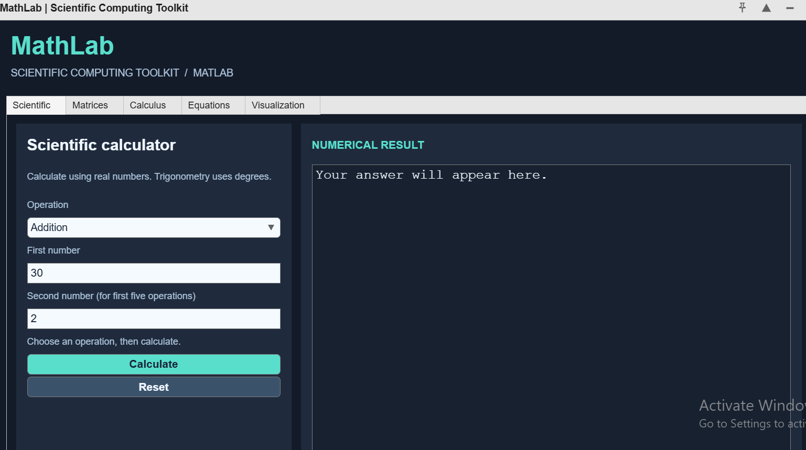
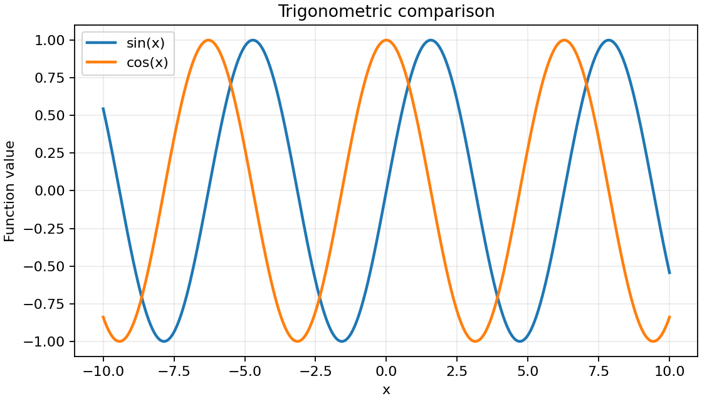
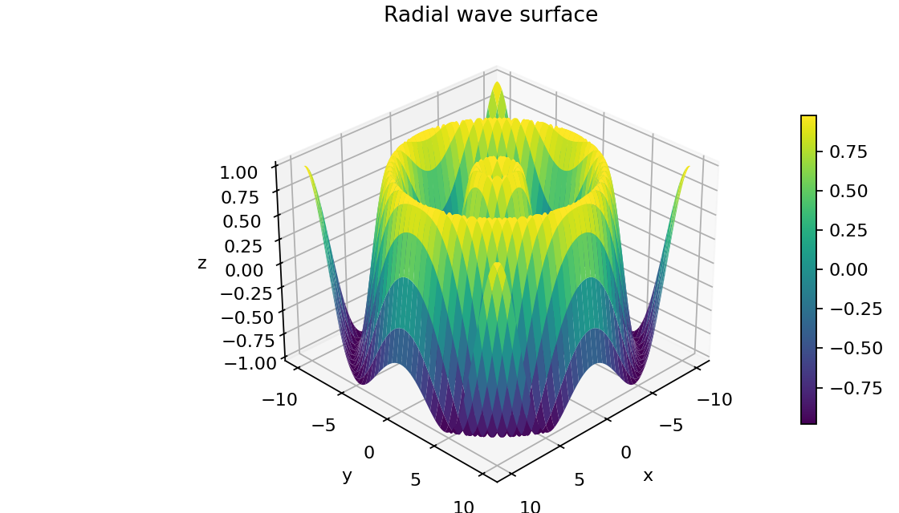
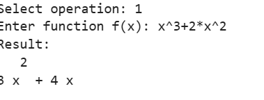

# MathLab — Scientific Computing Toolkit

**A MATLAB learning project that brings scientific calculation, linear algebra, calculus, equation solving and mathematical visualization into one graphical application.**

  



## About the project

I started MathLab while learning MATLAB during the fourth course of my five-course Coursera program. As a Computational Physics student, I wanted to apply my learning to a practical project that connects mathematics, programming and scientific visualization.

I began with a basic command-window calculator, then explored scientific functions, matrices, symbolic calculus, equation solving and plotting. The final step was integrating these features into a single dark-themed graphical interface using MATLAB's programmatic UI components.

## Features

| Module | Capabilities | MATLAB functions |
| --- | --- | --- |
| Scientific | Arithmetic, powers, square roots, trigonometry in degrees, logarithms, exponentials, factorial and absolute value | `sind`, `cosd`, `tand`, `sqrt`, `log`, `factorial` |
| Matrices | Addition, subtraction, multiplication, transpose, determinant, inverse, rank, eigenvalues, RREF and trace | `det`, `inv`, `rank`, `eig`, `rref`, `trace` |
| Calculus | Differentiation, indefinite and definite integration, higher-order derivatives and limits | `diff`, `int`, `limit` |
| Equations | Linear, quadratic, cubic, simultaneous and numerical nonlinear equation solving | `solve`, `vpasolve` |
| Visualization | Single and comparative 2D plots, 3D surfaces and filled contours | `fplot`, `surf`, `contourf` |

The GUI provides 38 operation choices across five tabs, input validation, result panels, reset buttons and embedded axes.

## Visualization examples

These reference plots were generated separately for the README to illustrate mathematical functions that can be entered into MathLab. They are **not screenshots of MATLAB or evidence of application tests**.

| 2D function comparison | 3D radial wave surface |
| --- | --- |
|  |  |
| `sin(x)` and `cos(x)` | `sin(sqrt(x^2+y^2))` |

## Requirements

- MATLAB with support for `uifigure`, `uigridlayout`, `uitabgroup`, `uiaxes` and `turbo`. A recent release is recommended; R2020b or newer is a reasonable starting point based on the functions used, not a verified minimum version.
- Symbolic Math Toolbox for the Calculus, Equations and Visualization tabs.
- No additional project files are needed to launch the GUI.

## Getting started

1. Download this repository using **Code → Download ZIP**, or clone it using Git.
2. Extract the files and open the project folder in MATLAB (or upload `MathLabGUI.m` to MATLAB Drive for MATLAB Online).
3. Make sure the Command Window shows the `>>` prompt. If another calculator is running, exit it with `0` or press `Ctrl+C`.
4. Run:

```matlab
MathLabGUI
```

5. Select a tab, choose an operation, enter your values and click **Calculate**, **Solve equations**, or **Generate graph**.

## Try it yourself

| Module | Operation | Input | Expected output |
| --- | --- | --- | --- |
| Scientific | Sine (degrees) | `30` | `0.5` |
| Matrices | Determinant | `[1 2; 3 4]` | `-2` |
| Calculus | Differentiation | `x^3+2*x^2` | `3*x^2+4*x` |
| Calculus | Definite integration | `x^2`, bounds `0` and `3` | `9` |
| Equations | Quadratic equation | `x^2-5*x+6==0` | `2`, `3` |
| Visualization | Compare two functions | `sin(x)`, `cos(x)`; range `-10` to `10` | Two wave curves |
| Visualization | 3D surface | `sin(sqrt(x^2+y^2))`; range `-10` to `10` | Radial wave surface |

Use `*` for explicit multiplication, `==` for equations, and semicolons to separate matrix rows. Scientific trigonometry uses degrees; symbolic functions and plots use radians. The numerical equation solver may find only one root near the chosen initial guess.

## Development journey

The project grew from command-line experiments into a GUI. Below is the actual differentiation output captured during development.



```text
MathLab-Scientific-Computing-Toolkit/
├── MathLabGUI.m              # Standalone graphical application
├── README.md                 # Documentation
├── .gitignore                # Ignore MATLAB backup files
├── examples/                 # Illustrative mathematical plots
├── screenshots/              # Actual development screenshots
└── legacy/
    └── MathLab.m             # Earlier scientific and matrix CLI version
```

## Learning outcomes

- Writing MATLAB functions, loops and conditional statements.
- Working with matrices and built-in numerical operations.
- Using the Symbolic Math Toolbox for mathematical expressions.
- Creating mathematical plots and interactive GUI components.
- Connecting classroom mathematics with scientific programming.

## Current status and future improvements

The GUI has been launched successfully in MATLAB by the project author. The author reported the application working; the test table provides reproducible expected results rather than a formal automated test report. The source has not been independently executed in MATLAB during preparation of this repository package.

Possible future improvements include calculation history, exporting results and graphs, more numerical methods, physics simulation modules and automated tests.

This is an educational toolkit, not a validated numerical engine for safety-critical or professional engineering calculations. Symbolic solvers may not return explicit solutions for every equation.

## Author

**Tabassum Tariq**  
BS Computational Physics · University of the Punjab, Lahore

Developed as a hands-on MATLAB learning project. The author ran and explored the application in MATLAB.
